# Lab 01 — Azure Storage Account and Blob Storage

## 1. Business Problem

A growing e-commerce company is building its development infrastructure in Microsoft Azure. The company needs a reliable, scalable, and secure way to store product-related files and application assets without maintaining physical storage infrastructure.

In this project, I evaluate Azure Blob Storage as a potential storage solution while considering access control, reliability, and operational costs.

## 2. Project Objective

The objective of this lab was to evaluate Azure Blob Storage for a simulated e-commerce company's development environment.

I deployed an Azure Storage Account and a private Blob container, uploaded and retrieved a test file, and verified that the downloaded content matched the original.

I also investigated an HTTP 403 authorization error, configured Azure RBAC permissions, and reviewed storage costs using Azure Cost Management.

This lab establishes the storage foundation for a larger, connected Azure infrastructure portfolio project.

## 3. Azure Resources and Configuration

| Setting | Configuration |
|---|---|
| Resource Group | rg-portfolio-dev |
| Storage Account | stportfolioaz90001 |
| Region | Sweden Central |
| Account Type | StorageV2 |
| Performance | Standard |
| Redundancy | Locally Redundant Storage (LRS) |
| Access Tier | Hot |
| Blob Container | portfolio-files |
| Container Access | Private |
| Test File | hello-azure.txt |

## 4. Implementation

1. I created a resource group to organize my Azure resources.
2. I deployed a Storage Account in Sweden Central.
3. I selected Standard performance, LRS redundancy, and the Hot access tier.
4. I created a private Blob container named portfolio-files.
5. I created a plain-text file named hello-azure.txt.
6. I uploaded the file to Azure Blob Storage using the Azure Portal.
7. I downloaded the file and compared it with the original.

## 5. Testing and Validation

I successfully uploaded and retrieved the file.

After downloading it, I opened the file locally and verified that its contents matched the original.

**Result:** The manual file upload and retrieval workflow worked successfully.

## 6. Security Considerations

- I configured a private container to prevent anonymous public access.
- Azure Storage provided encryption at rest using Microsoft-managed keys.
- Secure transfer was enabled to require HTTPS for supported REST operations.
- Blob and container soft delete were enabled with seven-day retention.
- Public network access was enabled from all networks. I recognize that additional network restrictions would be important to evaluate for sensitive production workloads.

## 7. Troubleshooting — Microsoft Entra ID and Azure RBAC

### Problem: Authorization Failure

When I initially attempted to access my private Blob container using Microsoft Entra ID authentication, Azure returned an authorization error.

Although my account had the **Owner** role at the subscription level, I could not list the files inside the container.

### Root Cause: Management Plane vs. Data Plane

I investigated the permissions and learned that Azure separates resource management permissions from data access permissions.

- **Management plane:** The Owner role allowed me to manage Azure resources and role assignments.
- **Data plane:** Accessing Blob contents through Microsoft Entra ID required an appropriate Storage Blob data role.

Having Owner permissions did not automatically grant Blob data access through Microsoft Entra ID.

### Solution: Apply Least-Privilege RBAC

To resolve the issue, I:

1. Opened **Access Control (IAM)** for the `portfolio-files` container.
2. Selected the built-in **Storage Blob Data Contributor** role.
3. Assigned the role to my Microsoft Entra ID user account.
4. Scoped the assignment to the specific Blob container rather than the entire subscription.
5. Returned to the container and tested access using Microsoft Entra ID authentication.

### Validation: Successful Access

After the role assignment took effect, I successfully listed the container contents using Microsoft Entra ID authentication and confirmed that `hello-azure.txt` was accessible.

This demonstrated that the authorization issue was caused by missing Blob data-plane permissions rather than an authentication failure.

### Key Learning

Azure RBAC permissions must match the operation being performed. The scope of a role assignment also matters.

For production workloads, I would prefer Microsoft Entra ID authentication with appropriately scoped RBAC permissions over routine use of shared storage account access keys.

### Troubleshooting Evidence

**1. Subscription-level Owner role before the fix**

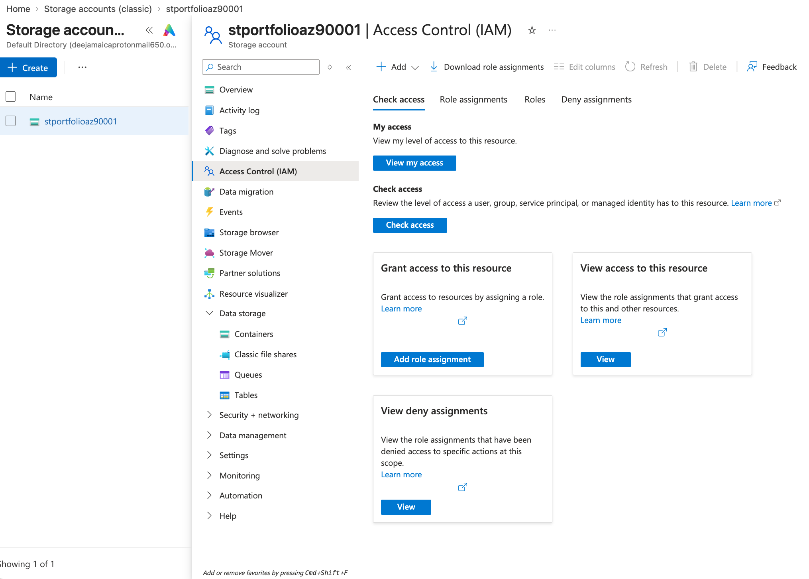

**2. Microsoft Entra ID authorization error**

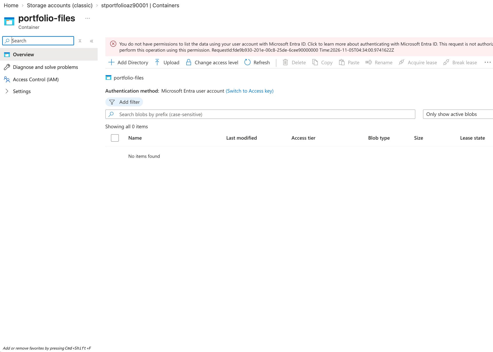

**3. Storage Blob Data Contributor assigned at container scope**

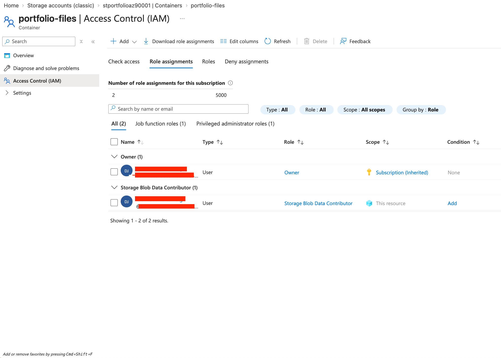

**4. Successful Blob access using Microsoft Entra ID**

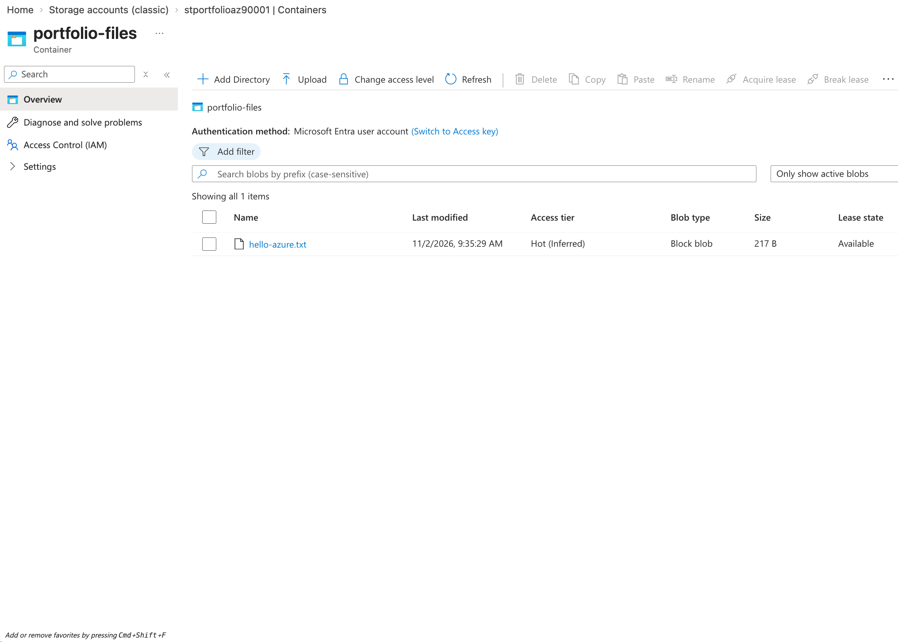

## 8. Cost and Design Decisions

**Cost Management:** I used Azure Cost Analysis to review spending by service and investigate the storage operations contributing to costs. I also created a subscription-level monthly budget of 50 SEK with email alerts at 50% (25 SEK), 80% (40 SEK), and 100% (50 SEK).

The reported cost during testing was less than 0.01 SEK. This helped me understand how cloud consumption can be monitored, although a budget alert does not automatically stop resources or prevent additional charges.

**Cost Monitoring Evidence**

**1. Cost analysis by service**

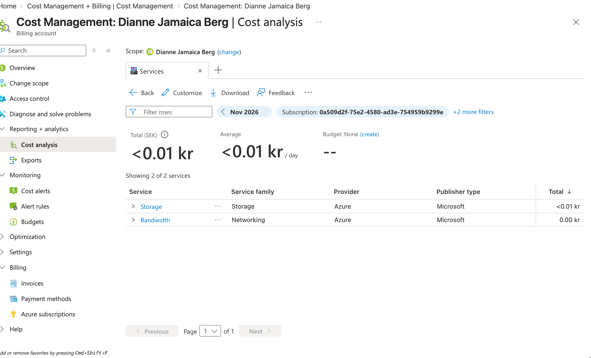

**2. Storage usage and metering**

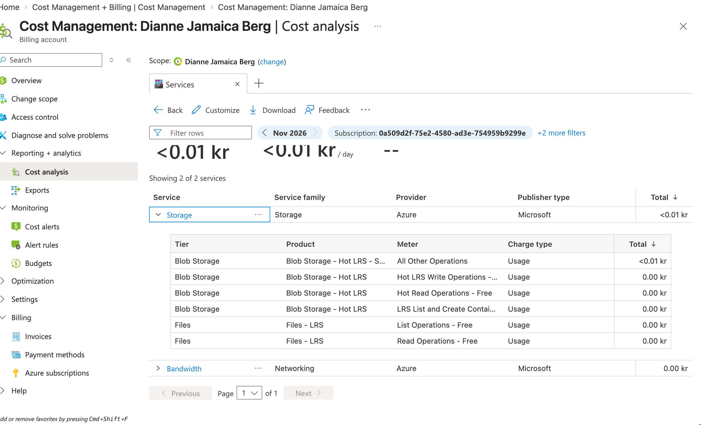

**3. Monthly budget and alerts**

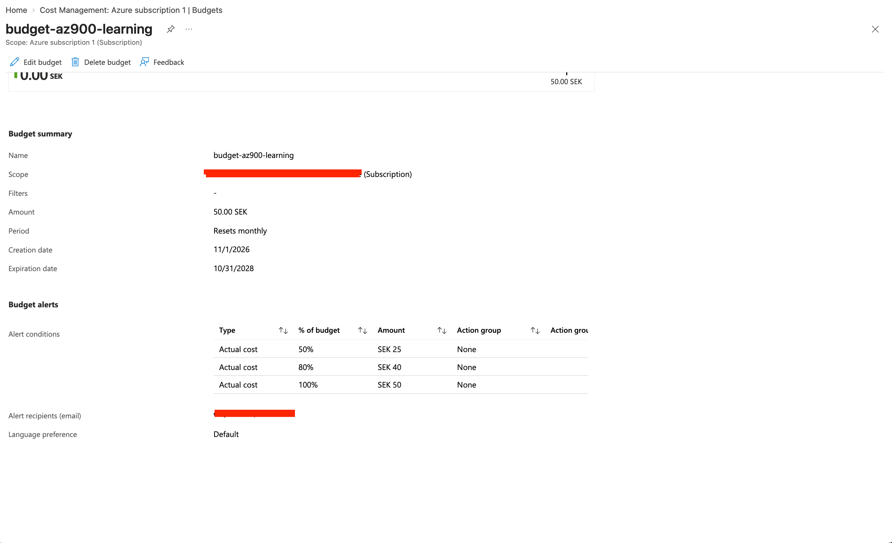

## 9. Future Improvements

- Configure Microsoft Entra ID authentication with least-privilege RBAC.
- Evaluate firewall rules and private endpoints.
- Explore Blob versioning and additional recovery options.
- Automate deployment using Azure CLI, Bicep, or Terraform.
- Review resource cleanup to avoid unnecessary ongoing charges.

## 10. Key Takeaways

This lab helped me understand how Azure Resource Groups, Storage Accounts, Blob containers, and individual blobs relate to one another.

I also gained practical experience with file upload and retrieval, access permissions, encryption, redundancy, and cost considerations.

My main takeaway is that Cloud Engineering involves more than deploying resources. It also requires understanding why configurations are chosen, validating that solutions work, and identifying improvements.

## 11. Evidence

### Azure Storage Account Overview
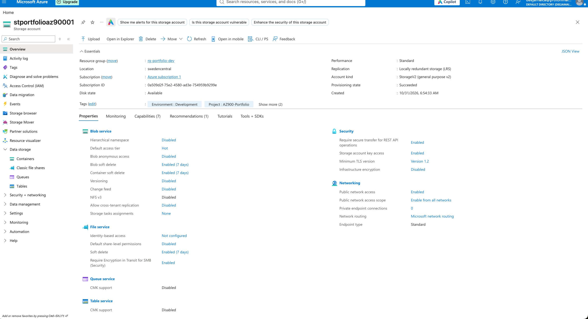

### Private Blob Container
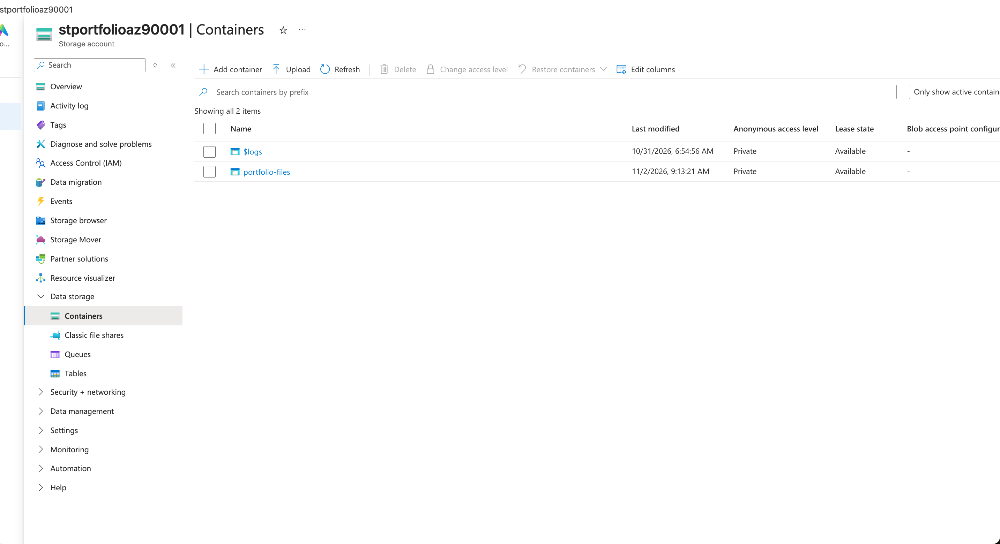

### Uploaded Blob File
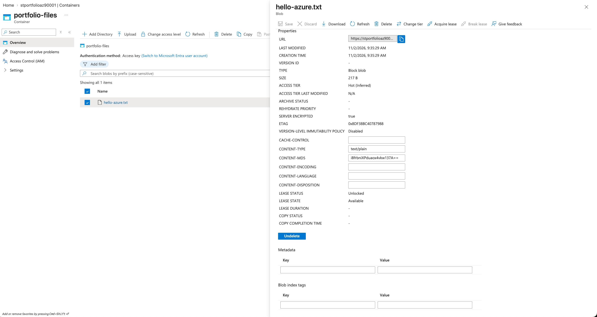

### Blob Retrieval and Validation
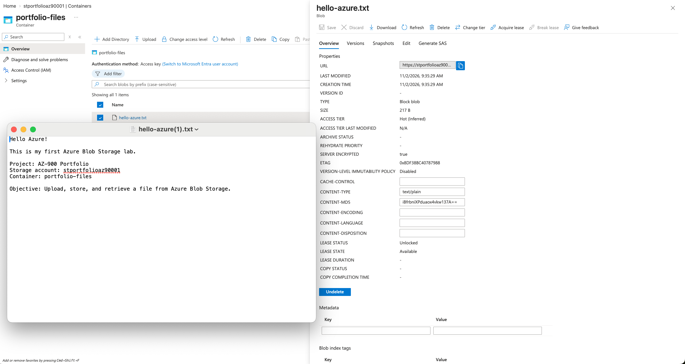

### Microsoft Entra ID Authorization Troubleshooting
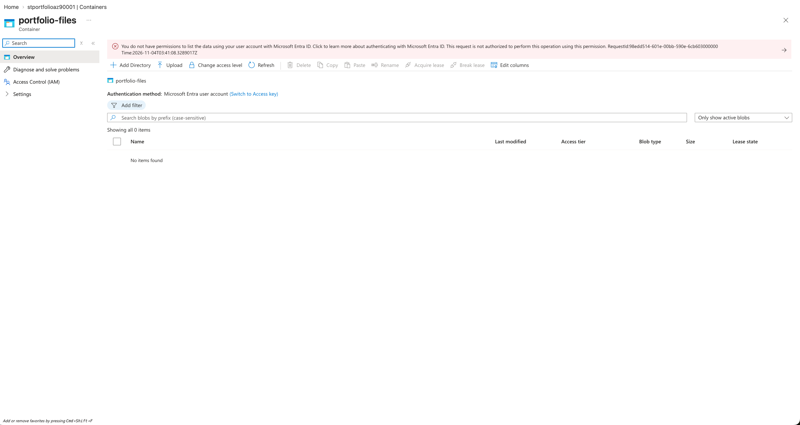

**Lab Status:** Completed — manual file upload and retrieval verified.

## 12. Connection to the Next Lab

This lab is part of a simulated e-commerce cloud infrastructure project.

In Lab 01, I deployed Azure Blob Storage to explore secure file storage, access permissions, and cost management.

In Lab 02, I expanded the same development environment by deploying an Azure Virtual Network with separate application and private endpoint subnets.

Both resources belong to the same Azure Resource Group, `rg-portfolio-dev`, but they are not yet connected through a private endpoint.

The goal is to progressively develop this environment through networking, security, governance, infrastructure as code, and automation.

[Continue to Lab 02 — Virtual Network and Subnets](../02-azure-virtual-network-subnets/README.md)
