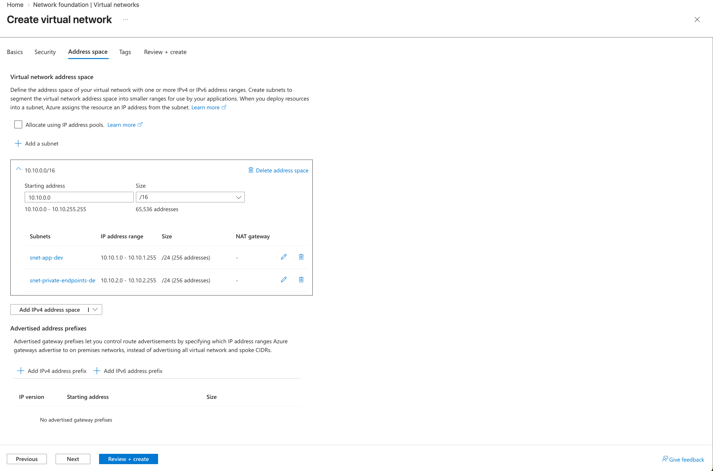
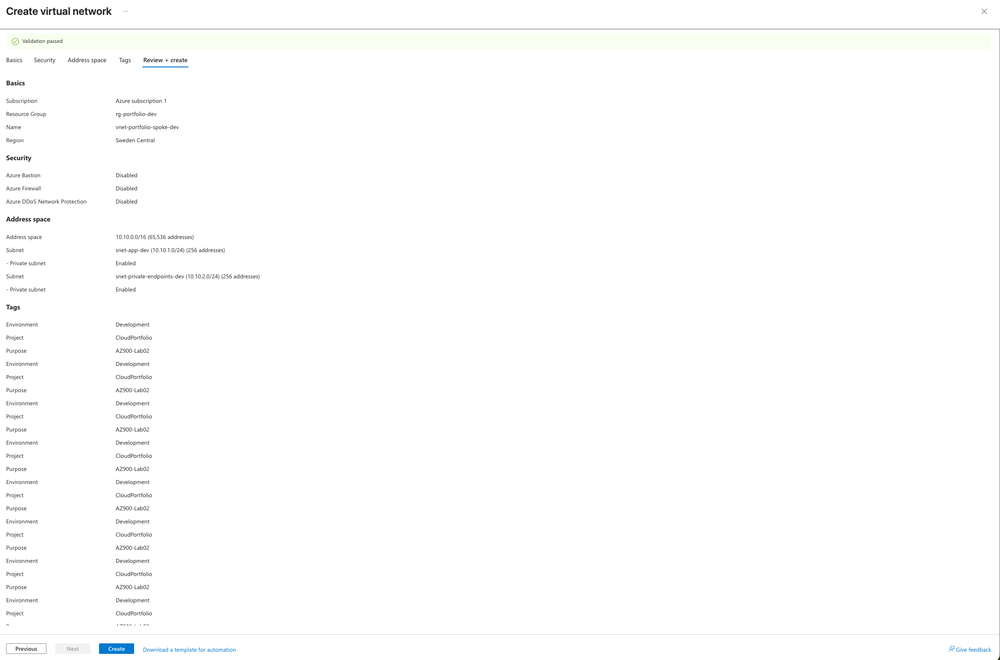
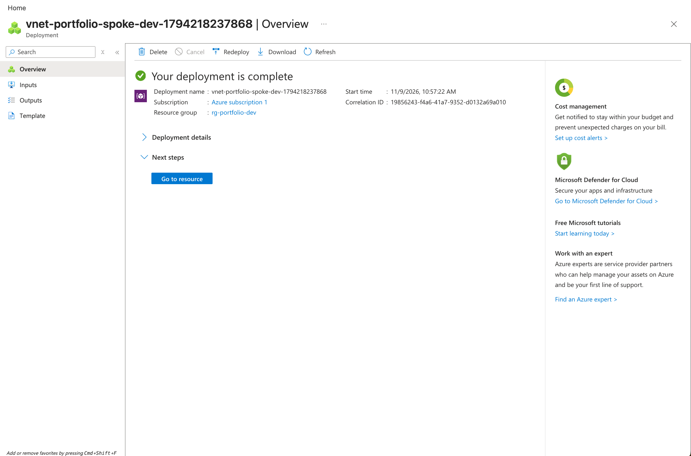
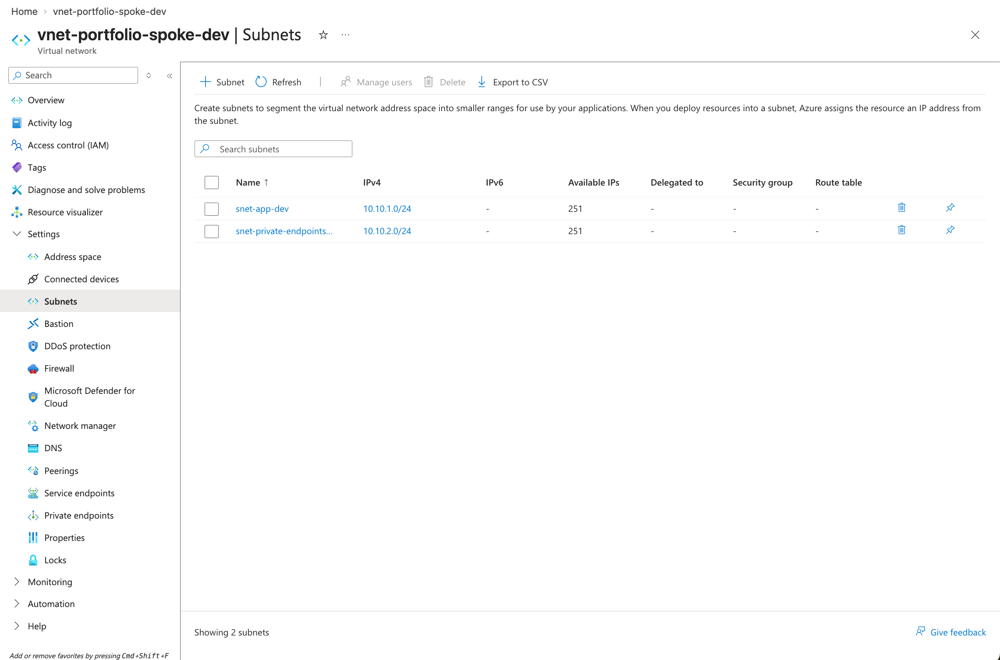

# Lab 02 — Azure Virtual Network and Subnets

## 1. Business Problem

An e-commerce company needs a structured private network in Microsoft Azure to support future application workloads and secure connections to cloud services.

Placing all resources in a single network segment can make network organization and security management more difficult as the environment grows.

In this lab, I explored how Azure Virtual Networks and subnets provide a foundation for organizing cloud resources and preparing for network security controls.

## 2. Objective

Create an Azure Virtual Network with two separate subnets, understand IPv4 address allocation, and verify the deployed network configuration.

## 3. Azure Resources and Configuration

| Resource | Configuration |
|---|---|
| Resource Group | `rg-portfolio-dev` |
| Region | Sweden Central |
| Virtual Network | `vnet-portfolio-spoke-dev` |
| VNet Address Space | `10.10.0.0/16` |
| Application Subnet | `snet-app-dev` |
| Application Subnet Range | `10.10.1.0/24` |
| Private Endpoints Subnet | `snet-private-endpoints-dev` |
| Private Endpoints Subnet Range | `10.10.2.0/24` |
| Default Outbound Access | Disabled for both subnets |
| NAT Gateway | Not configured |
| Network Security Groups | Not configured |

## 4. Implementation

### Step 1 — Create a Virtual Network

Used the Azure Portal to create a VNet in the existing development resource group, selecting Sweden Central as the deployment region.

### Step 2 — Configure IPv4 Address Space

Configured the VNet address space as `10.10.0.0/16`, providing a private IPv4 address range for future network resources.

### Step 3 — Create Two Subnets

Created two non-overlapping subnets:

- `snet-app-dev` (`10.10.1.0/24`) for future application resources.
- `snet-private-endpoints-dev` (`10.10.2.0/24`) for future private endpoint connections to Azure services.

Each /24 subnet contains 256 IPv4 addresses. Azure reserves five addresses per subnet, leaving 251 available IP addresses.

### Step 4 — Review Security Settings

Enabled the private subnet setting for both subnets to avoid default outbound internet access.

Did not configure Azure Bastion, Azure Firewall, a NAT Gateway, or enhanced DDoS Network Protection because these were not required for this introductory lab.

### Step 5 — Deploy and Verify

Completed Azure deployment validation and deployed the VNet successfully.

Verified that both subnets appeared in the Azure Portal with the expected IP address ranges and 251 available IP addresses each.

## 5. Design and Security Decisions

**Why create two subnets?**

Separate subnets improve network organization and allow different security policies to be applied to different workloads.

**Why use non-overlapping IP ranges?**

Non-overlapping ranges avoid IP address conflicts and support clearer network planning.

**Why use private subnets?**

Disabling default outbound access allows outbound connectivity to be configured explicitly when required.

**Does subnet separation automatically provide isolation?**

No. Subnets within a VNet can communicate by default, subject to routing and security controls. Network Security Groups can be used to restrict traffic.

## 6. Validation Evidence

The following screenshots document the deployment and configuration:

- Successful VNet deployment.
- Virtual Network overview.
- Verification of both subnets and their IPv4 address ranges.

Screenshots are stored in the `screenshots/` folder.

## 7. Cost Considerations

Creating a standard Azure Virtual Network and subnets does not normally incur a direct hourly charge.

Additional services, such as NAT Gateway, Azure Firewall, and Azure Bastion, may incur charges. These were not deployed in this lab.

## 8. Key Learnings

- Understood the purpose of Azure Virtual Networks.
- Learned how to plan private IPv4 address spaces.
- Created two non-overlapping subnets.
- Learned why Azure reserves five IP addresses per subnet.
- Understood the difference between subnet organization and network security enforcement.
- Practiced verifying deployed Azure networking resources.

## 9. Next Steps

- Explore Azure Network Security Groups.
- Understand inbound and outbound network rules.
- Learn how Azure resources communicate inside a Virtual Network.
- Continue developing hands-on Azure networking knowledge.

---

**Lab Status:** Completed and verified  
**Certification:** Microsoft Azure Fundamentals (AZ-900)

## Deployment Evidence

### 1. Virtual Network Address Space

### 2. Configuration Validation

### 3. Successful Deployment

### 4. Subnet Verification

  
