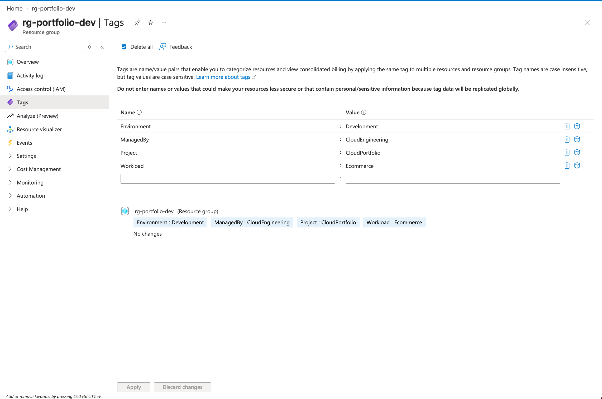
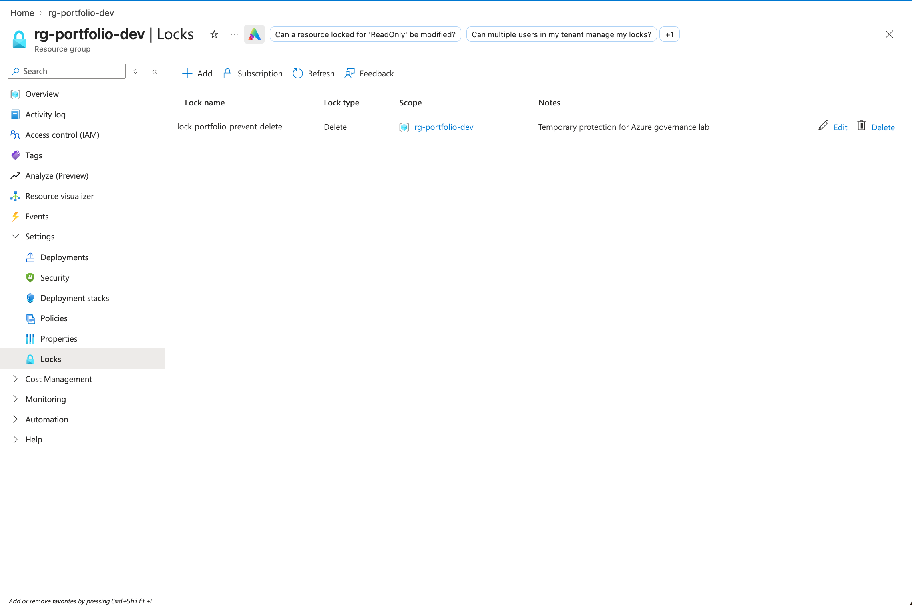
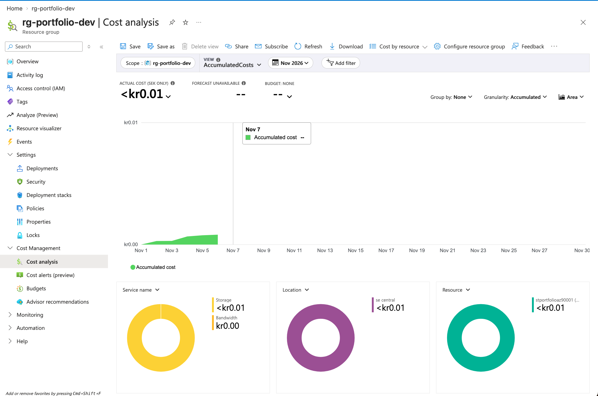

# Lab 03 — Azure Resource Governance and Cost Management

## 1. Business Problem

A growing e-commerce company has deployed its initial Azure storage and networking infrastructure.

As the environment expands, the company needs to organize its resources, reduce the risk of accidental deletion, and monitor cloud spending.

This lab explores Azure governance and cost management using the existing development resource group.

## 2. Project Objective

Apply Azure resource tags, configure a resource-group delete lock, and review accumulated costs using Azure Cost Management.

This lab builds on the storage and networking foundations established in Labs 01 and 02.

## 3. Azure Resources and Configuration

| Setting | Configuration |
|---|---|
| Resource Group | `rg-portfolio-dev` |
| Region | Sweden Central |
| Environment | Development |
| Project | CloudPortfolio |
| Workload | Ecommerce |
| ManagedBy | CloudEngineering |
| Resource Lock | `lock-portfolio-prevent-delete` |
| Lock Type | CanNotDelete (Delete) |
| Cost Management Scope | Resource Group |
| Cost Analysis Period | November 2026 |
| Budget | Existing subscription-level budget (Lab 01) |

### Resource Tags

I verified four tags on the existing Azure Resource Group:

- `Environment: Development`
- `ManagedBy: CloudEngineering`
- `Project: CloudPortfolio`
- `Workload: Ecommerce`

These tags help organize Azure resources and support governance, reporting, and cost allocation.

### Resource Protection

I configured a CanNotDelete lock at the Resource Group scope to reduce the risk of accidental deletion.

The lock prevents deletion of protected resources but does not prevent all modifications.

### Cost Monitoring

I reviewed accumulated Azure costs for November 2026 using Azure Cost Management.

The displayed actual cost was less than SEK 0.01 at the time of review, with Storage accounting for the reported usage.

A subscription-level budget was previously configured in Lab 01. No additional budget was created in Lab 03.

## 4. Implementation

### Step 1 — Configure Resource Tags

Opened the existing resource group `rg-portfolio-dev` in the Azure Portal and reviewed its tags.

Verified the following tags:

- Environment: Development
- ManagedBy: CloudEngineering
- Project: CloudPortfolio
- Workload: Ecommerce

These tags provide consistent resource classification and support governance and cost reporting.

### Step 2 — Configure a Resource Lock

Navigated to Resource Group > Settings > Locks.

Configured a resource-group-level lock:

- Lock name: `lock-portfolio-prevent-delete`
- Lock type: CanNotDelete (Delete)
- Scope: `rg-portfolio-dev`

Verified that the lock appeared in the Azure Portal.

### Step 3 — Review Azure Cost Analysis

Navigated to Resource Group > Cost Management > Cost analysis.

Reviewed accumulated costs for November 2026.

The Azure Portal displayed an actual cost below SEK 0.01, primarily associated with Azure Storage.

The existing subscription-level budget was configured in Lab 01, so no additional budget was created.

## 5. Governance and Security Decisions

### Why use resource tags?

Tags help identify and organize Azure resources by environment, project, workload, and management responsibility.

They support resource tracking, cost analysis, and operational governance.

### Why configure a CanNotDelete lock?

A CanNotDelete lock reduces the risk of accidentally deleting important Azure resources.

Because the lock is applied at the Resource Group level, it also protects resources within that group from deletion.

However, this lock does not prevent all configuration changes and is not a replacement for Azure RBAC.

### Why review costs at the Resource Group level?

Resource Group cost analysis helps identify spending associated with a particular environment or project.

In this lab, the accumulated cost was below SEK 0.01 at the time of review.

The existing subscription-level budget from Lab 01 provides a separate cost-monitoring control.

### Operational Considerations

- Resource tags do not automatically enforce security policies.
- Resource locks do not control who can access resource data.
- Azure RBAC is used to manage permissions.
- A CanNotDelete lock must be removed by an authorized user before deleting protected resources.
- Azure costs should be reviewed regularly because consumption and pricing can change.

## 6. Validation Evidence

The following screenshots demonstrate the Azure governance configurations and cost analysis completed in this lab.

### 1. Resource Group Tags

Verified four tags applied to `rg-portfolio-dev` for resource organization and governance.

### 2. Resource Group Delete Lock

Verified that the `CanNotDelete` lock was configured at the Resource Group level.

### 3. Azure Cost Analysis

Reviewed accumulated costs for November 2026 at the Resource Group scope.

At the time of review, the reported cost was below SEK 0.01, primarily associated with Azure Storage.

